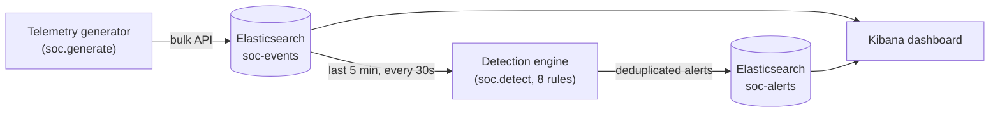

# Mini SOC Dashboard

A home-lab Security Operations Center built on the **Elastic Stack**. It covers simulated telemetry, **8 detection rules mapped to MITRE ATT&CK**, severity-based alerting, and a Kibana dashboard that refreshes every 30 seconds.

> **Origin:** My FIU capstone team (CIS3950, Spring 2026) designed this SOC: the mission and scope, 8 detection use cases, severity scheme, and dashboard layout. I was Product Owner. The capstone ended at the design stage, so I built this working implementation myself.


## How it works



- **Telemetry:** a fictional 24-host company (20 workstations, a DC, file/web/DB servers, a vuln scanner, an admin jump box). It produces logons, process starts, network flows, and group changes, in a format based on ECS (Elastic Common Schema). Each event is labeled with ground truth, so detection accuracy can be measured.
- **Detection:** every 30 seconds, all 8 rules run over the last 5 minutes of events. An alert gets a stable ID, so the same activity seen again updates one alert instead of creating duplicates.
- **Dashboard:** alerts by severity, alerts over time, top source IPs, MITRE techniques, a live alert feed, and a lab-only true/false-positive panel.

## Detection use cases

| ID | Use case | Severity | MITRE ATT&CK | Logic (5-minute window) |
|---|---|---|---|---|
| UC1 | Brute force authentication | 🟠 High | T1110 | ≥10 failed logons from one external IP (≥25 if the source is internal) |
| UC2 | Malware execution | 🔴 Critical | T1204.002 | Process started with a SHA-256 hash on the IOC list |
| UC3 | Lateral movement | 🟠 High | T1021 | One internal IP logs on to ≥3 hosts over SMB/RDP/WinRM |
| UC4 | Privilege escalation | 🟠 High | T1098 | Account added to Domain/Enterprise/Schema Admins or Administrators |
| UC5 | Data exfiltration | 🔴 Critical | T1048 | One host sends ≥50 MB to external IPs |
| UC6 | Unauthorized access attempt | 🟡 Medium / 🔵 Low | T1078 | Logon attempts on a disabled account (≥3 is Medium, otherwise Low) |
| UC7 | Suspicious PowerShell | 🟠 High | T1059.001 | `-enc`, `IEX`, `DownloadString`, hidden window, `-ExecutionPolicy Bypass` |
| UC8 | Reconnaissance | 🟡 Medium | T1046 | One source probes ≥20 ports on one target |

## Results

Measured with `python3 -m soc.evaluate --hours 24 --seed 7`: 24 simulated hours, about 76,000 events, 137 injected attacks.

| | Before tuning | After tuning |
|---|---|---|
| Attacks detected | 137 / 137 | 137 / 137 |
| False-positive alerts | **59** | **0** |

### Tuning

The simulation includes legitimate activity that looks like attacks. The first untuned run flagged all of it:

| False positives (untuned) | Cause | Fix |
|---|---|---|
| 20 × Brute force | Users mistyping their own password 10+ times on their own PC | Higher threshold for internal sources (25 vs. 10) |
| 15 × Lateral movement | IT admins RDP-ing to servers from the jump box | Allowlist `ADM-JUMP01` |
| 14 × Data exfiltration | Nightly offsite backup from the file server | Allowlist the approved backup provider's IP |
| 8 × Reconnaissance | The authorized vulnerability scanner | Allowlist `SRV-VULNSCAN` |

**Trade-offs I accepted:** an insider brute-forcing from an internal workstation now has to fail 25 times instead of 10 before an alert fires. An attacker who compromises the jump box, the scanner, or the backup destination is exempt from those rules. In a real SOC, I'd cover those gaps with separate, narrower rules, such as alerting on jump-box logons outside a change window. Run `python3 -m soc.evaluate --no-tuning` to reproduce the untuned numbers.

### Limitations

- **The data is synthetic, and I wrote both the attacks and the rules,** so 100% detection here doesn't mean 100% in the real world. The point of this lab is the pipeline, the detection logic, and the tuning process.
- Elasticsearch security is **disabled** to keep the lab simple. Port 9200 listens only on localhost inside the VM, and Kibana is forwarded only to `127.0.0.1` on the host. Don't expose this stack to a network.
- It covers detection only, with no automated response.

## Quick start

Full setup, including the Ubuntu VM: **[docs/vm-setup.md](docs/vm-setup.md)**

```bash
docker compose up -d                       # Elasticsearch + Kibana
python3 -m soc.setup_stack                 # index templates + Kibana data views
python3 -m soc.generate --backfill-hours 6 # 6 hours of history
python3 -m soc.detect --backfill-hours 6   # alert on that history
```

Then build the dashboard: **[docs/dashboard-guide.md](docs/dashboard-guide.md)**. You can also import `dashboards/mini-soc-dashboard.ndjson` under Stack Management → Saved Objects.

**Live mode:** run `python3 -m soc.generate` and `python3 -m soc.detect` in two terminals. To fire a specific attack: `python3 -m soc.generate --attack brute_force`

**Tests** (no Elastic needed): `python3 -m unittest discover tests -v`

Uses only the Python 3 standard library, so there's nothing to `pip install`.

## Repository layout

```
docker-compose.yml     Elasticsearch + Kibana (single node)
soc/environment.py     Simulated company: hosts, users, IOCs, allowlists
soc/events.py          Benign traffic, look-alikes, and 8 attack scenarios
soc/rules.py           The 8 detection rules
soc/detect.py          Detection engine (30s interval, 5-min window, dedup)
soc/generate.py        Sends telemetry to Elasticsearch
soc/evaluate.py        Offline accuracy test against ground truth
soc/setup_stack.py     Index mappings + Kibana data views
tests/                 Unit tests for every rule
docs/                  VM setup, dashboard build guide, screenshots
dashboards/            Exported Kibana dashboard (.ndjson)
```

## What's next

- Port the rules to **Sigma** and to Kibana's built-in detection engine
- Ship real Windows logs from a Windows VM with **Winlogbeat + Sysmon**, then validate the rules against **Atomic Red Team** tests
- Add a low-and-slow brute force scenario (spread out to stay under the 5-minute threshold) and a longer-window rule to catch it

## Notes

All hosts, users, and IPs are fictional. External addresses use the RFC 5737 documentation ranges. The "malware" hashes are SHA-256 digests of placeholder strings, not real samples.

